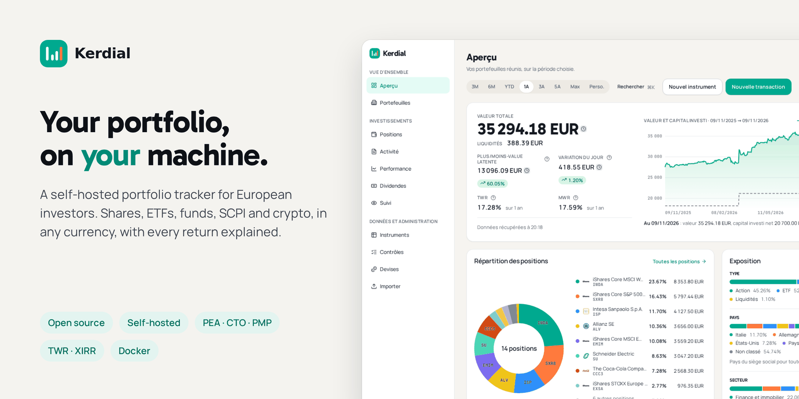
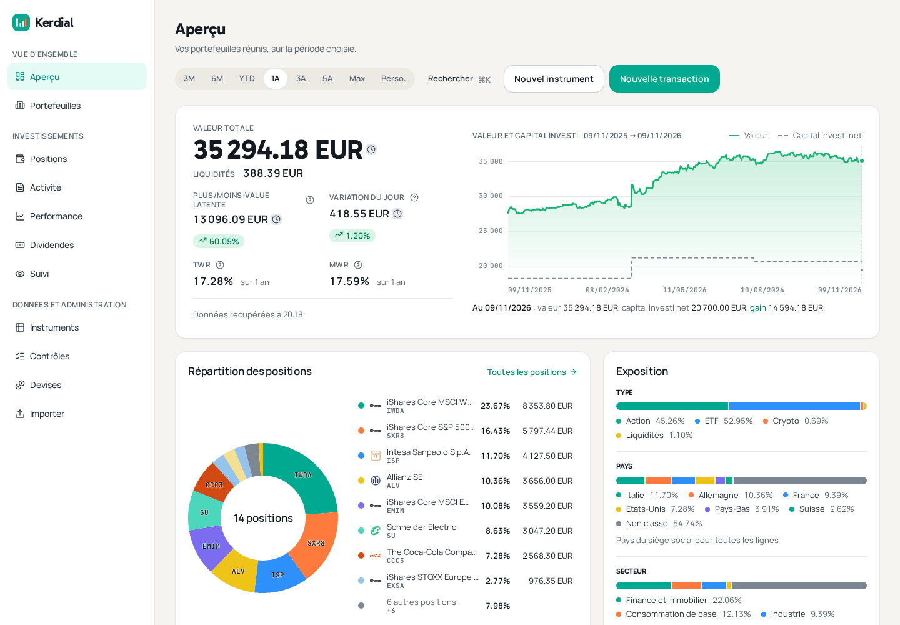
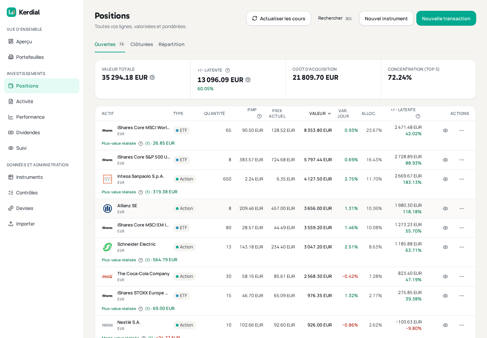
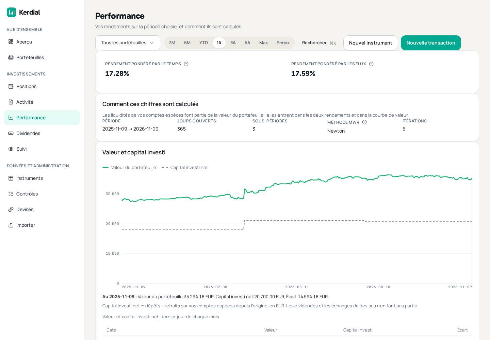
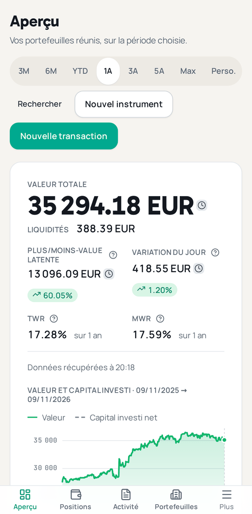

# Kerdial

**Kerdial est un outil de suivi de portefeuille libre et gratuit, que vous hébergez vous-même.** Il suit
vos actions, ETF, fonds, SCPI et crypto-actifs sur plusieurs portefeuilles et plusieurs devises, les
valorise chaque jour et vous dit comment vos placements se sont réellement comportés. Il fonctionne avec
Docker sur votre ordinateur, votre serveur ou votre NAS : vos données financières restent entre vos
mains. L'interface est en français.

[](https://github.com/kerdial/kerdial/actions/workflows/ci.yml)
[](LICENSE)
[](https://github.com/kerdial/kerdial/releases/latest)
[](https://hub.docker.com/r/kerdial/kerdial)

**Site web :** [www.kerdial.com](https://www.kerdial.com/) · **English:** [README.md](README.md)

## Pourquoi Kerdial

- **Vos données restent chez vous.** Kerdial n'est pas un site sur lequel on s'inscrit. Vous
  l'installez sur votre propre machine, et vos portefeuilles sont enregistrés dans votre propre base de
  données.
- **Pensé pour les investisseurs français et européens.** Suivez côte à côte un PEA, un compte-titres
  (CTO) et un portefeuille crypto, chacun comme un portefeuille distinct. Le prix de revient suit la
  méthode française du prix moyen pondéré (PMP). Les OPCVM sont valorisés automatiquement, et les SCPI
  peuvent être suivies avec les prix que vous saisissez.
- **Plusieurs devises.** Détenez titres et liquidités en euros, en dollars ou dans toute autre devise,
  avec les taux de change de la Banque centrale européenne, ou le taux exact appliqué par votre
  courtier.
- **Des chiffres fiables.** Tous les montants sont calculés en arithmétique décimale exacte, jamais en
  nombres à virgule flottante arrondis. Chaque cours indique s'il est à jour, saisi à la main ou reporté
  d'un jour précédent : vous savez toujours si un chiffre est frais.

## Fonctionnalités

- **Portefeuilles.** Autant que vous voulez, valorisés chacun séparément et tous ensemble, sur la
  période de votre choix.
- **Tous les types d'opérations.** Achats, ventes, dépôts, retraits, dividendes, dividendes réinvestis,
  attributions d'actions, intérêts sur les liquidités, frais de compte, opérations de change, et
  transferts d'une ligne d'un portefeuille à un autre. Frais et taxes peuvent être saisis opération par
  opération ; un dividende enregistre sa retenue à la source et affiche le montant net.
- **Instruments.** Actions, ETF, fonds (y compris les OPCVM), crypto-actifs et SCPI. Les cours sont
  récupérés automatiquement auprès de Yahoo Finance ; tout ce qu'aucun fournisseur ne couvre peut être
  valorisé à la main.
- **Liquidités.** Les soldes en espèces de chaque portefeuille comptent dans sa valeur, sa répartition
  et ses performances.
- **Performances.** Le rendement pondéré par le temps (TWR), qui mesure vos choix d'investissement, et
  le rendement pondéré par les capitaux (XIRR), qui mesure ce qu'a rapporté votre argent, calendrier des
  versements compris.
- **Écrans.** Une vue d'ensemble avec un graphique de la valeur et du capital investi et un graphique de
  répartition, vos positions, un écran de performance qui peut isoler un portefeuille, des calendriers
  des dividendes et de l'activité, et une liste de suivi.
- **Import et export.** Importez votre historique depuis Portfolio Performance. Exportez tout dans deux
  fichiers et réimportez-les : une copie complète de ce que vous avez saisi.
- **Sur votre téléphone.** Utilisable sur un écran de téléphone, et installable comme une application
  sur l'écran d'accueil (PWA).
- **Un foyer, une installation.** Le premier compte est l'administrateur. Il peut créer des accès pour
  les autres membres du foyer, qui voient et gèrent alors les mêmes portefeuilles.

## Captures d'écran

Toutes les captures montrent des données de démonstration inventées.









## Démarrage rapide

Il vous faut un ordinateur, un serveur ou un NAS équipé d'un **processeur x86-64** (Intel ou AMD) et de
**Docker avec Docker Compose** (Docker Desktop, sous Windows et macOS, inclut les deux). L'image n'est
pas construite pour les appareils ARM comme le Raspberry Pi. Kerdial utilise environ 1 Go de mémoire au
repos, et davantage pendant le chargement de l'historique des cours : prévoyez au moins 2 Go de mémoire
libre (4 Go sur un NAS, voir le [guide Synology](docs/deploy-synology.md)). Il a aussi besoin d'une
connexion internet pour récupérer les cours et les taux de change.

Les commandes ci-dessous s'exécutent dans un shell bash : le terminal sous Linux et macOS. Sous Windows,
lancez-les dans un terminal WSL (par exemple Ubuntu, installé avec WSL 2 ; Docker Desktop utilise lui
aussi WSL 2), et non dans PowerShell ou l'invite de commandes.

**1. Téléchargez les deux fichiers de configuration** dans un nouveau dossier :

```bash
mkdir kerdial && cd kerdial
curl -fsSLO https://raw.githubusercontent.com/kerdial/kerdial/main/deploy/docker-compose.yml
curl -fsSLO https://raw.githubusercontent.com/kerdial/kerdial/main/deploy/.env.example
cp .env.example .env
```

**2. Générez les quatre mots de passe** dont l'installation a besoin. Cette commande remplit chaque
ligne vide correspondante de `.env` avec une valeur aléatoire :

```bash
for name in POSTGRES_SUPERUSER_PASSWORD APP_WEB_PASSWORD APP_INGEST_PASSWORD CSRF_SECRET; do
  sed -i.bak "s/^${name}=\$/${name}=$(openssl rand -hex 24)/" .env
done
rm .env.bak
```

Vous pouvez aussi ouvrir `.env` dans un éditeur de texte et coller, après chacun de ces quatre noms, une
valeur obtenue avec `openssl rand -hex 24`. Gardez `.env` confidentiel et conservez-en une copie. Le
premier, `POSTGRES_SUPERUSER_PASSWORD`, ne peut plus être changé une fois la base de données créée.

**3. Démarrez Kerdial :**

```bash
docker compose up -d --wait
```

Le premier démarrage télécharge environ 400 Mo et prépare la base de données ; il peut prendre quelques
minutes. La commande rend la main une fois que tout fonctionne.

**4. Créez votre compte.** L'écran de premier lancement demande un jeton d'installation à usage
unique, que Kerdial affiche dans son journal. Pour le lire :

```bash
docker compose logs api | grep 'setup token' | tail -1
```

La commande affiche une longue ligne de journal. Le jeton, ce sont les 43 lettres, chiffres, `-` et `_`
qui suivent `first-run setup token (required by POST /auth/setup): `, jusqu'au guillemet fermant. Chaque
redémarrage affiche un nouveau jeton, et seul le dernier est valable.

Ouvrez ensuite **<http://localhost:3000>** dans Chrome ou Edge, sur la même machine (Safari refuse les
cookies de connexion de Kerdial en `http://` simple, même sur `localhost`). Remplissez le formulaire
« Configuration initiale » : votre e-mail, un mot de passe, votre devise de référence et le jeton
(« Jeton d'installation »). Ce compte est l'administrateur. Tant qu'il n'existe pas, l'écran de
configuration est ouvert à quiconque détient le jeton : c'est pourquoi Kerdial n'est d'abord accessible
que depuis la machine elle-même.

### Ouvrir Kerdial depuis un autre appareil

Par défaut, Kerdial ne répond que sur la machine où il tourne (`API_BIND=127.0.0.1`), et ses cookies de
connexion ne circulent qu'en HTTPS (`COOKIE_SECURE=true`). Chrome et Edge font une exception pour
`localhost` : la connexion fonctionne donc sur la machine elle-même ; depuis un autre appareil, il faut
l'une des deux configurations ci-dessous. Modifiez les lignes dans `.env`, puis relancez
`docker compose up -d --wait`.

**Sur votre réseau domestique, sans HTTPS.** Créez d'abord votre compte (étape 4), puis indiquez :

```bash
API_BIND=0.0.0.0
TRUST_PROXY=
COOKIE_SECURE=false
```

Ouvrez `http://<adresse de la machine>:3000` depuis n'importe quel appareil de votre réseau. Votre mot
de passe et votre session circulent alors en clair sur ce réseau : ne le faites que sur un réseau de
confiance, et n'ouvrez jamais ce port sur internet.

**Derrière un proxy inverse en HTTPS** (Caddy, nginx, Traefik, le proxy inverse intégré de Synology…)
sur la même machine : gardez `API_BIND=127.0.0.1`, `TRUST_PROXY=1` et `COOKIE_SECURE=true`, et faites
pointer le proxy vers `http://127.0.0.1:3000`. Kerdial ne fournit ni proxy ni certificats : leur mise
en place vous revient. Les autres configurations, comme un proxy sur une autre machine, sont décrites
dans le [guide de déploiement](docs/deploy-runbook.md#1-exposure-api_bind-and-trust_proxy) (en
anglais).

**Sur un NAS Synology**, suivez [docs/deploy-synology.md](docs/deploy-synology.md) (en anglais ;
modèles « + » Intel/AMD, DSM 7.2 ou ultérieur avec Container Manager).

Le [guide de déploiement](docs/deploy-runbook.md) détaille chaque réglage.

## Mises à jour et sauvegardes

**Mettre à jour.** Depuis le dossier qui contient votre `docker-compose.yml` :

```bash
docker compose pull
docker compose up -d --wait
```

La base de données est mise à jour automatiquement au démarrage. Si vous avez fixé une version dans
`APP_IMAGE` (fichier `.env`), modifiez-la d'abord. Lisez les
[notes de version](docs/release-notes.md) (en anglais) avant de mettre à jour. N'utilisez jamais
`docker compose down -v` pour une mise à jour : cette commande supprime la base de données.

> **Vous utilisez une version 0.1.x ?** La version 0.2.0 a renommé l'installation, et une simple mise
> à jour démarre sur une base de données neuve et vide. Suivez d'abord
> [Upgrading from 0.1.x (portfolio stack) to 0.2.0](docs/deploy-runbook.md#upgrading-from-01x-portfolio-stack-to-020)
> (en anglais). Vos données ne sont pas supprimées. Si l'écran de premier lancement s'affiche déjà, ne
> le remplissez pas : c'est la nouvelle installation, vide, dans laquelle la procédure ci-dessus déplace
> vos données.

**Sauvegardes.** Kerdial ne se sauvegarde pas tout seul. Vous avez deux moyens d'en garder une copie :

- **Depuis l'application :** l'écran « Importer » exporte toutes vos données dans deux fichiers (un
  catalogue des instruments et une liste des opérations), que l'on peut réimporter dans une
  installation vide.
- **Toute la base de données :** une copie et une restauration manuelles, décrites dans
  [le guide](docs/deploy-runbook.md#3-taking-a-copy-of-the-database-and-restoring-one--by-hand)
  (en anglais).

Ces deux copies ne sont pas chiffrées et contiennent tout votre portefeuille : rangez-les en lieu sûr.

## Importer vos données

Sur l'écran « Importer », Kerdial lit :

- les exports CSV de **Portfolio Performance** : la liste des titres, les opérations du compte-titres
  et celles du compte espèces. Seuls les exports réalisés avec Portfolio Performance en français sont
  pris en charge pour l'instant (noms de colonnes et format des nombres en français). Importez d'abord
  les titres, pour que Kerdial connaisse chaque instrument cité par les opérations ;
- **son propre export** : les deux fichiers décrits plus haut, pour une sauvegarde ou un changement de
  machine.

Chaque import montre ce qu'il va faire avant d'écrire quoi que ce soit, et importer deux fois le même
fichier ne crée pas de doublons. Vous pouvez aussi écrire un fichier Kerdial à la main dans un tableur :
le format est décrit dans [docs/import-export-format.md](docs/import-export-format.md).

## Ce que Kerdial n'est pas

- **Pas connecté à votre banque ni à votre courtier.** Kerdial ne se connecte à aucun compte et ne
  synchronise rien automatiquement. Vous saisissez vos opérations ou vous les importez depuis un
  fichier.
- **Pas un conseil en investissement.** Kerdial montre ce que vous détenez et comment cela s'est
  comporté. Il ne recommande rien.
- **Pas un outil fiscal.** Il ne prépare ni déclaration ni formulaire fiscal. Pour Kerdial, un PEA ou
  un CTO est un nom de portefeuille ; il n'applique aucune règle propre à l'enveloppe.
- **Pas une plateforme de courtage.** On ne peut ni acheter ni vendre depuis Kerdial.
- **Pas un service hébergé.** Il n'y a pas de compte Kerdial à créer en ligne : chaque installation
  est indépendante et tourne sur une machine que vous contrôlez.
- **Pas (encore) en anglais.** L'interface n'existe qu'en français.

## Développement

Kerdial est écrit en TypeScript (NestJS, React, PostgreSQL). Pour le compiler et lancer les tests, il
faut Node.js 22, pnpm 9 et Docker. [CONTRIBUTING.md](CONTRIBUTING.md) explique l'installation et les
vérifications à lancer, et [docs/run-local.md](docs/run-local.md) comment lancer l'application depuis
les sources (tous deux en anglais). Questions et idées sont les bienvenues dans les
[Discussions GitHub](https://github.com/kerdial/kerdial/discussions) ; merci de signaler les failles de
sécurité en privé, comme indiqué dans [SECURITY.md](SECURITY.md).

## Licence

Copyright (C) 2026 Nicolas Berthel.

Kerdial est un logiciel libre, distribué sous la
[licence publique générale GNU Affero v3.0](LICENSE) (AGPL-3.0-only). Vous pouvez l'utiliser, le
modifier et le redistribuer ; si vous proposez une version modifiée comme service en réseau, l'AGPL vous
oblige à en offrir le code source à ses utilisateurs.
