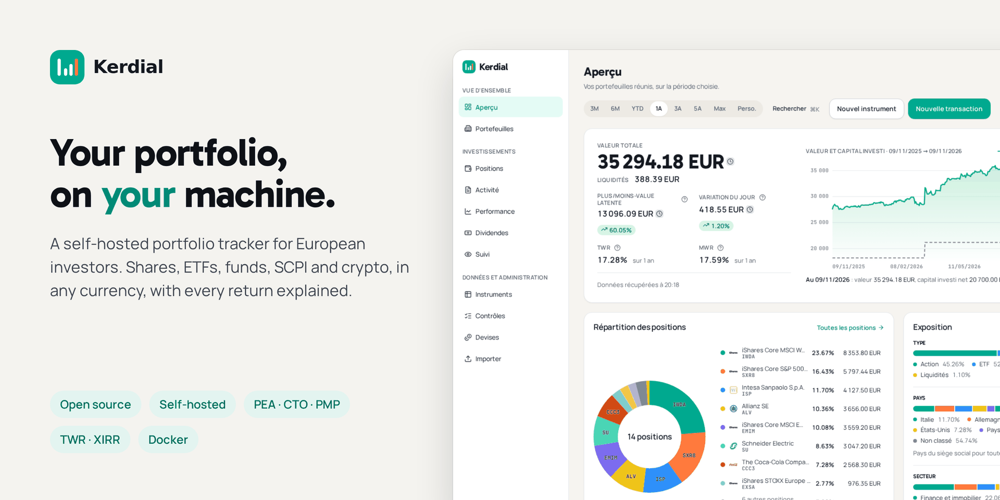
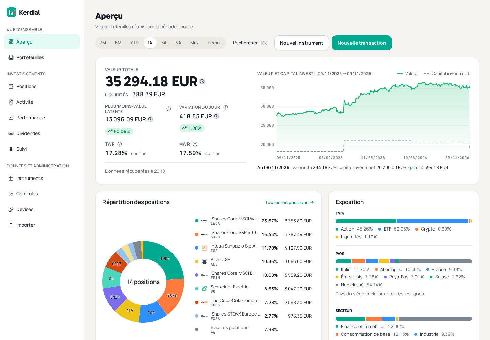
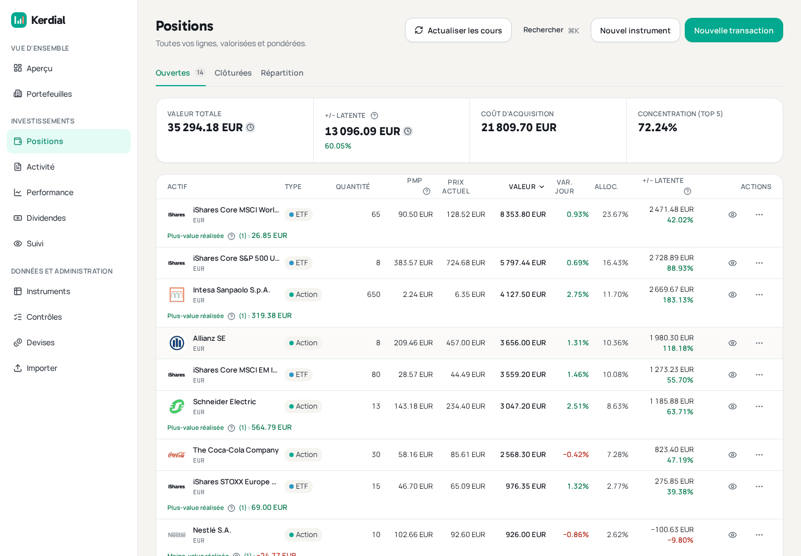
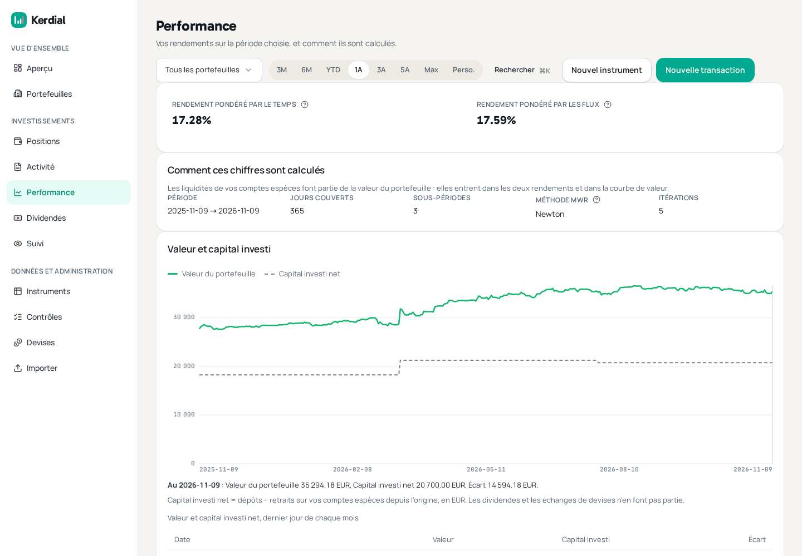
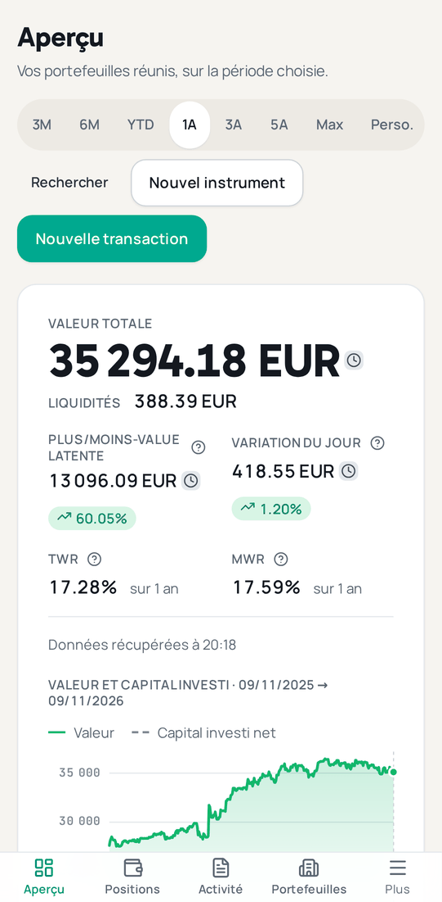

# Kerdial

**Kerdial is a free, open-source portfolio tracker that you host yourself.** It follows your shares,
ETFs, funds, SCPI and crypto-assets across several portfolios and currencies, values them every day,
and tells you how your investments actually performed. It runs with Docker on your own computer, server
or NAS, so your financial data never leaves your hands. The interface is in French.

[](https://github.com/kerdial/kerdial/actions/workflows/ci.yml)
[](LICENSE)
[](https://github.com/kerdial/kerdial/releases/latest)
[](https://hub.docker.com/r/kerdial/kerdial)

**Website:** [www.kerdial.com](https://www.kerdial.com/) · **Français :** [README.fr.md](README.fr.md)

## Why Kerdial

- **Your data stays at home.** Kerdial is not a website you sign up to. You install it on your own
  machine, and your portfolios are stored in your own database.
- **Made for European and French investors.** Keep a PEA, a securities account (CTO) and a crypto wallet
  side by side as separate portfolios. Cost basis uses the French weighted-average method (PMP, _prix
  moyen pondéré_). French mutual funds (OPCVM) are priced automatically, and SCPI can be followed with
  prices you enter yourself.
- **Several currencies.** Hold assets and cash in euros, dollars or any other currency, with European
  Central Bank exchange rates, or the exact rate your broker applied.
- **Figures you can trust.** Every amount is calculated with exact decimal arithmetic, never rounded
  floating-point numbers. Each price shows whether it is live, entered by hand or carried forward from an
  earlier day, so you always know how fresh a figure is.

## Features

- **Portfolios.** As many as you like, each valued on its own and all together, over the period you
  choose.
- **Every kind of transaction.** Buys, sells, deposits, withdrawals, dividends, reinvested dividends,
  share distributions, interest on cash, account fees, currency exchanges, and transfers of a holding
  from one portfolio to another. Fees and taxes can be recorded per transaction; a dividend records its
  withholding tax and shows the net amount.
- **Instruments.** Shares, ETFs, funds (including French OPCVM), crypto-assets and SCPI. Prices are
  fetched automatically from Yahoo Finance; anything no provider covers can be priced by hand.
- **Cash.** Each portfolio's cash balances count in its value, its allocation and its returns.
- **Returns.** Time-weighted return (TWR), which measures your investment choices, and money-weighted
  return (XIRR), which measures what your own money earned, timing of deposits included.
- **Screens.** An overview with a value-and-invested-capital chart and an allocation chart, your
  positions, a performance screen that can isolate one portfolio, dividend and activity calendars, and a
  watchlist.
- **Import and export.** Import your history from Portfolio Performance. Export everything to two files
  and import them back — a complete copy of what you entered.
- **On your phone.** Usable at phone width, and installable as an app on your home screen (PWA).
- **A household, one instance.** The first account is the administrator. It can create logins for other
  members of the household, who then see and manage the same portfolios.

## Screenshots

All screenshots show invented demo data.









## Quick start

You need a computer, server or NAS with an **x86-64 processor** (Intel or AMD) and **Docker with Docker
Compose** installed (Docker Desktop on Windows and macOS includes both). The image is not built for ARM
devices such as a Raspberry Pi. Kerdial uses about 1 GB of memory when idle and more while it loads price
history, so plan for 2 GB or more of free memory (4 GB on a NAS, see the
[Synology guide](docs/deploy-synology.md)). It also needs an internet connection to fetch prices and
exchange rates.

The commands below are for a bash shell: the terminal on Linux and macOS. On Windows, run them in a WSL
terminal (for example Ubuntu, installed with WSL 2; Docker Desktop uses WSL 2 too), not in PowerShell or
the Command Prompt.

**1. Download the two configuration files** into a new folder:

```bash
mkdir kerdial && cd kerdial
curl -fsSLO https://raw.githubusercontent.com/kerdial/kerdial/main/deploy/docker-compose.yml
curl -fsSLO https://raw.githubusercontent.com/kerdial/kerdial/main/deploy/.env.example
cp .env.example .env
```

**2. Generate the four passwords** the stack needs. This fills each empty line of `.env` with a random
value:

```bash
for name in POSTGRES_SUPERUSER_PASSWORD APP_WEB_PASSWORD APP_INGEST_PASSWORD CSRF_SECRET; do
  sed -i.bak "s/^${name}=\$/${name}=$(openssl rand -hex 24)/" .env
done
rm .env.bak
```

You can also open `.env` in a text editor and paste a value from `openssl rand -hex 24` after each of
those four names. Keep `.env` private and keep a copy of it. The first one,
`POSTGRES_SUPERUSER_PASSWORD`, cannot be changed once the database has been created.

**3. Start Kerdial:**

```bash
docker compose up -d --wait
```

The first start downloads about 400 MB and prepares the database; it can take a few minutes. The
command returns once everything is running.

**4. Create your account.** The first-run screen asks for a one-time setup token, which Kerdial prints
in its log. Read it with:

```bash
docker compose logs api | grep 'setup token' | tail -1
```

The command prints one long log line. The token is the 43 letters, digits, `-` and `_` that follow
`first-run setup token (required by POST /auth/setup): `, up to the closing quote. Each restart prints a
new token, and only the latest one works.

Then open **<http://localhost:3000>** in Chrome or Edge on the same machine (Safari refuses Kerdial's
login cookies over plain `http://`, even on `localhost`). Fill in the « Configuration initiale » form:
your e-mail, a password, your reference currency and the token (« Jeton d'installation »). This account
is the administrator. Until it exists, the setup screen is open to anyone who holds the token, which is
why Kerdial starts out reachable only from the machine itself.

### Opening Kerdial from another device

Out of the box, Kerdial only answers on the machine it runs on (`API_BIND=127.0.0.1`), and its login
cookies are only sent over HTTPS (`COOKIE_SECURE=true`). Chrome and Edge make an exception for
`localhost`, so logging in on the machine itself works; from another device you need one of these two
set-ups. Change the lines in `.env`, then run `docker compose up -d --wait` again.

**On your home network, without HTTPS.** Create your account first (step 4), then set:

```bash
API_BIND=0.0.0.0
TRUST_PROXY=
COOKIE_SECURE=false
```

Open `http://<address of the machine>:3000` from any device on your network. Your password and session
then travel unencrypted on that network: do this only on a network you trust, and never forward this
port to the internet.

**Behind a reverse proxy with HTTPS** (Caddy, nginx, Traefik, Synology's built-in reverse proxy…) on the
same machine: keep `API_BIND=127.0.0.1`, `TRUST_PROXY=1` and `COOKIE_SECURE=true`, and point the proxy
at `http://127.0.0.1:3000`. Kerdial does not include a proxy or certificates; setting them up is up to
you. Other layouts, such as a proxy on a different machine, are covered in the
[deployment runbook](docs/deploy-runbook.md#1-exposure-api_bind-and-trust_proxy).

**On a Synology NAS**, follow [docs/deploy-synology.md](docs/deploy-synology.md) (Intel/AMD "+"
models, DSM 7.2 or later with Container Manager).

The [deployment runbook](docs/deploy-runbook.md) explains every setting in detail.

## Upgrading and backups

**Upgrading.** From the folder that holds your `docker-compose.yml`:

```bash
docker compose pull
docker compose up -d --wait
```

The database is updated automatically on start. If you pinned a version in `APP_IMAGE` in `.env`,
change it first. Read the [release notes](docs/release-notes.md) before upgrading. Never use
`docker compose down -v` to upgrade: it deletes the database.

> **Running 0.1.x?** Version 0.2.0 renamed the stack, and a plain upgrade starts on a new, empty
> database. Follow
> [Upgrading from 0.1.x (portfolio stack) to 0.2.0](docs/deploy-runbook.md#upgrading-from-01x-portfolio-stack-to-020)
> first. Your data is not deleted. If you already see the first-run setup screen, do not complete it:
> that is the new, empty instance, and the procedure above moves your data into it.

**Backups.** Kerdial does not back itself up. You have two ways to keep a copy:

- **From the app:** the « Importer » screen exports all your data to two files (an instrument catalogue
  and a transaction list) that can be imported back into an empty installation.
- **The whole database:** a manual dump and restore, described in
  [the runbook](docs/deploy-runbook.md#3-taking-a-copy-of-the-database-and-restoring-one--by-hand).

Both copies are unencrypted and contain your whole portfolio: store them somewhere safe.

## Import your data

On the « Importer » screen, Kerdial reads:

- **Portfolio Performance** CSV exports: the securities list, the portfolio transactions and the
  account transactions. Only exports made with Portfolio Performance in French are supported for now
  (French column names and number format). Import the securities first, so that Kerdial knows every
  instrument the transactions refer to.
- **Kerdial's own export**: the two files described above, for a backup or a move to another machine.

Every import shows what it would do before anything is written, and importing the same file twice does
not create duplicates. You can also write a Kerdial file by hand in a spreadsheet: the format is
documented in [docs/import-export-format.md](docs/import-export-format.md) (in French).

## What Kerdial is not

- **Not connected to your bank or broker.** Kerdial does not log in to any account and does not sync
  anything automatically. You enter your transactions or import them from a file.
- **Not financial advice.** Kerdial shows what you own and how it performed. It does not recommend
  anything.
- **Not a tax tool.** It does not prepare tax returns or tax forms. A PEA or a CTO is a portfolio name
  to Kerdial; it applies no tax-wrapper rules.
- **Not a trading platform.** You cannot buy or sell from Kerdial.
- **Not a hosted service.** There is no Kerdial account to sign up for: each installation is
  independent and runs on a machine you control.
- **Not in English (yet).** The interface is in French only.

## Development

Kerdial is written in TypeScript (NestJS, React, PostgreSQL). To build it and run the tests you need
Node.js 22, pnpm 9 and Docker. [CONTRIBUTING.md](CONTRIBUTING.md) explains the set-up and the checks to
run, and [docs/run-local.md](docs/run-local.md) how to run the app from source. Questions and ideas are
welcome in [GitHub Discussions](https://github.com/kerdial/kerdial/discussions); please report security
issues privately as described in [SECURITY.md](SECURITY.md).

## License

Copyright (C) 2026 Nicolas Berthel.

Kerdial is free software, licensed under the
[GNU Affero General Public License v3.0](LICENSE) (AGPL-3.0-only). You may use, modify and redistribute
it; if you run a modified version as a network service, the AGPL requires you to offer its source code
to its users.
